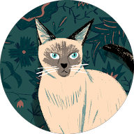
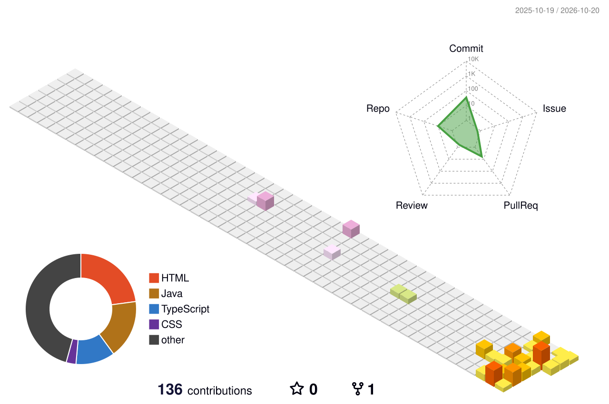

#  Hello! 👋 I'm Adrián

**Web Application Development (DAW) Student** 💻

 

 

I'm interested in web development and, above all, backend development with Java.

## 🔭 What I'm doing now
- 📚 Studying a higher vocational degree in Web Application Development (DAW)
- 🌱 Learning Git, GitHub and application deployment
- ☕ Improving my Java and backend skills

## 🚀 Featured projects
- 🧵 **Handmade thread clothing online store**: final project of my degree. [View repository](https://github.com/AdrianDW7/REPO-NAME)

## 🛠️ Technologies

## 📫 Contact
- LinkedIn: [My profile](https://www.linkedin.com/in/adrián-domínguez-wencesla-b9b38639a)
- Email: adriandw72005@gmail.com

## 🌐 My contributions

## 📊 GitHub stats

